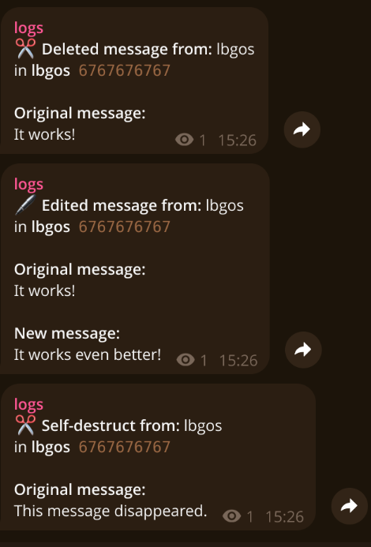

# TGLOG

专为个人 Telegram 账号打造的消息日志记录工具。它在本地维护消息缓存，并将被删除或编辑过的消息实时转发至指定的私人日志频道。同时支持媒体文件缓存，因此即使对方在 Telegram 中删除了图片或视频，缓存的媒体依然完好保留。

这是一个注重实用性的后台工具：纯粹简洁的 Python、轻量高效的 SQLite 以及一行 Docker Compose 命令即可快速启动。

请仅在您拥有监控权限的账号、聊天与数据上使用此工具。本地缓存中包含私有消息内容，请务必将 `data/` 目录像密码管理器备份一样妥善保管。

## 效果示例
### 图片与视频同样支持！


## 功能特性

- 实时监听已连接 Telegram 账号的收发消息（包括接收与发送）
- 将已删除和已编辑的消息由 Telegram 机器人自动转发至指定的私有群组或频道
- **特定人员消息实时转发**：支持监听特定群聊中指定发言人（可一人或多人）的消息并实时克隆转发（无视防复制/防转发限制）
- 在媒体被撤回或删除前提前下载照片、视频及文档（支持设置文件体积上限）
- 阅后即焚（TTL）媒体送达时立即尝试保存
- 使用 SQLite 进行持久化本地缓存，并在达到设定的容量限制时自动清理历史数据与对应媒体
- 支持官方原生验证码与两步验证 (2FA) 认证
- 支持按私聊、群组、频道以及指定聊天 ID（黑白名单）进行灵活过滤

## 安装与配置

您需要先从 [my.telegram.org](https://my.telegram.org) 获取 Telegram API ID 和 Hash，并准备一个用于接收日志的私有频道。

创建本地配置文件并填入相应参数：

```bash
mkdir -p data
cp config.example.json data/config.json
```

核心配置项说明：

- `api_id` 与 `api_hash`: Telegram 开发者凭据
- `phone`: 您的账号手机号（如 `+8613800000000`）
- `password`: 两步验证 (2FA) 密码（可选；若填写则启动时自动完成 2FA 校验，留空则在终端手动输入）
- `bot_token`: Telegram 机器人 Token（向 [@BotFather](https://t.me/BotFather) 申请）
- `log_channel_id`: 接收日志的私有群组或频道数字 ID（**请务必将机器人拉入该群组/频道并赋予发消息与发媒体权限**）

注意：`data/config.json`、Telegram 会话凭据、SQLite 缓存数据库以及下载的媒体文件均已在 Git 中忽略，不会被意外提交。

## 使用 Docker 运行

### 1. 首次运行（交互登录认证）
由于首次登录需要向终端输入验证码和 2FA 密码，请使用**直通终端模式**启动（避免 Docker 拦截键盘输入）：

```bash
docker compose run --rm -it logger
```

按照屏幕提示操作：
1. 终端提示输入收到的 5 位 Telegram 验证码；
2. 若账号开启了 2FA（两步验证）且未在配置文件中预填 `password`，终端会提示输入 2FA 密码；
3. 验证通过后，终端输出 `已成功登录为 ...` 即可按 `Ctrl + C` 退出。

### 2. 正式在后台稳定运行
会话已安全持久保存在 `data/` 目录中，直接启动后台守护进程：

```bash
docker compose up -d
```

## 本地直接运行（不使用 Docker）

```bash
python -m venv .venv
source .venv/bin/activate
pip install -r requirements.txt
python logger.py
```

## 配置项详解

- `mode`: 设置为 `whitelist`（白名单）或 `blacklist`（黑名单）以启用对应的 ID 列表过滤；设置为 `all` 则记录所有聊天。
- `ignored_ids`: 用于忽略特定聊天，通常用于排除日志频道本身的 ID，防止循环记录。
- `ignore_bots`: 是否忽略/过滤 Telegram 机器人（Bot）消息，默认为 `true`。开启后群内迎宾、管群、打卡等各类机器人的消息不会被记录到日志或缓存，但 `forward_rules` 中明确指定的发件人仍会被正常转发。
- `ignore_auto_deleted`: 是否忽略群聊自带的到期定时自动删除，默认为 `true`。开启后系统会根据群聊设置的自动删除倒计时（如 1 天、3 天、7 天）智能计算，系统到期自动清理的消息会自动从本地静默移除，绝不推送到日志频道刷屏；而未到期的人为主动提前撤回依然会精准捕获并正常记录。
- `max_deleted_age_hours`: 允许记录撤回的最大消息存活小时数，默认为 `72`（3 天）。超过该时间的历史远古删除一律静默清理，防止任何老消息被清理时刷屏；设为 `0` 则不限制。
- `whitelist`: 白名单列表（当 `mode` 设为 `whitelist` 时生效）。支持填入纯群聊 ID（记录该群全员），或对象格式（**仅记录该群里指定的某几个人**）：
  ```json
  "whitelist": [
    -1001234567890,
    {
      "chat_id": -1009876543210,
      "sender_ids": [123456789, 987654321]
    }
  ]
  ```
  - `chat_id`: 目标群聊 ID；
  - `sender_ids`: 该群中允许记录的用户 ID 列表（支持一人或多人）。该群中仅指定人员的消息、编辑和撤回会被记录；群内其他人的消息不会存库，撤回亦不会触发播报。
- `cache_size`: 本地保留的最大消息条数。当超出限制时，最早的消息记录及其关联的本地缓存媒体文件将被同步清理。
- `forward_rules`: 特定群聊中特定人员的消息实时转发规则列表。支持无视群组防复制防转发限制。格式如下：
  ```json
  "forward_rules": [
    {
      "source_chat_id": -1001234567890,
      "sender_ids": [123456789],
      "target_chat_id": -1009876543210
    }
  ]
  ```
  - `source_chat_id`: 监听来源群聊 ID；
  - `sender_ids`: 需转发的发言人用户 ID 列表（支持一人或多人）；
  - `target_chat_id`: 转发目标群聊 ID（留空默认发送到 `log_channel_id`）。
- `keyword_alerts`: 频道关键词监控与 MacroDroid 手机闹钟 Webhook 联动规则列表。当目标频道出现指定关键词的消息时，自动触发手机自动化动作。格式如下：
  ```json
  "keyword_alerts": [
    {
      "enabled": true,
      "channels": [-1001234567890, "example_channel"],
      "keywords": ["补货", "优惠"],
      "webhook_url": "https://trigger.macrodroid.com/YOUR_DEVICE_ID/YOUR_TRIGGER_NAME",
      "cooldown_seconds": 10
    }
  ]
  ```
  - `channels`: 监听的频道列表，支持填数字 ID 或公开用户名（如 `"example_channel"`）；
  - `keywords`: 关键词列表（大小写不敏感，命中任意一个即告警）；
  - `webhook_url`: MacroDroid Webhook 触发地址；
  - `cooldown_seconds`: 防抖冷却时间（秒，防止短时间内重复触发手机闹钟）。
- 默认配置会记录所有类型的消息。在正式账号上使用前，建议根据个人实际需要调整聊天类型开关和媒体体积限制。

## 技术栈

- Python 3.14
- [Telethon](https://github.com/LonamiWebs/Telethon)
- SQLite (WAL 模式)
- Docker Compose
